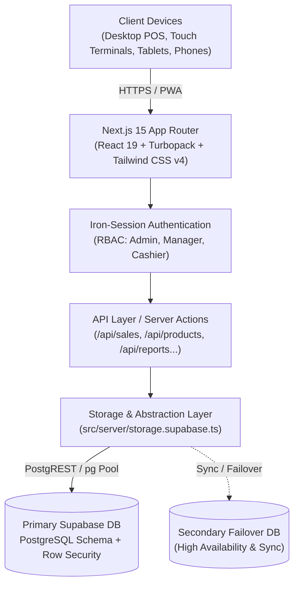

<div align="center">

# 👗 WTS Cloth Inventory & POS System
**High-performance Point of Sale (POS) & Inventory Management Platform tailored for retail apparel and textile businesses.**

[](https://nextjs.org/)
[](https://react.dev/)
[](https://www.typescriptlang.org/)
[](https://tailwindcss.com/)
[](https://supabase.com/)
[](https://developer.mozilla.org/en-US/docs/Web/Progressive_web_apps)

<br/>

[Features](#-key-features) •
[Architecture](#-system-architecture) •
[Quickstart](#-getting-started) •
[Database & Backups](#-backup--disaster-recovery) •
[Configuration](#-environment-variables) •
[Project Structure](#-project-structure)

</div>

---

## 🌟 Key Features

### 🛒 1. Advanced Point of Sale (POS)
- **Rapid Checkout & Barcode Scanning**: Instant product lookup via hardware laser scanners, camera scan, or real-time fuzzy text search.
- **Smart Bargaining & Price Negotiation**:
  - Configure **Floor Price** and **Minimum Selling Price** per product.
  - Interactive price adjustments with visual alerts to protect gross margins.
  - Salesperson attribution with customizable negotiation tolerance.
- **Flexible Billing & Split Payments**: Accept Cash, UPI, Cards, or combined payments with automated change calculation.
- **Receipts & Invoicing**:
  - Direct 80mm / 58mm Thermal Fast Print via ESC/POS and browser printing.
  - 1-Click **WhatsApp Digital Receipt** sharing with direct customer messaging.
  - Professional PDF export and thermal barcode rendering.

### 📦 2. Real-Time Inventory & Catalog Management
- **Hierarchical Categories & Variants**: Organize fabrics, readymade apparel, and accessories by size, color, and fabric type.
- **Automated SKU & Barcode Generation**: Built-in barcode generator conforming to standard retail symbologies.
- **Stock Movements & Audit Trails**: Every inbound restock, sale, return, or manual adjustment is recorded with user attribution and timestamps.
- **Safety Stock & Low Inventory Alerts**: Real-time dashboard warnings when products fall below their minimum inventory thresholds.
- **Non-Destructive Operations**: Safe soft-delete and instant one-click restoration for catalog protection.

### 👥 3. Customer & Staff Intelligence
- **Instant Customer Lookup**: Search by phone number or name; auto-fill during POS checkout.
- **Customer Lifetime Value (LTV)**: Track total visits, order frequencies, and total lifetime spend.
- **Salesperson Performance**: Attribute every sale to staff members to track sales volumes and commissions.

### 🚚 4. Purchasing & Supplier Management
- **Vendor Directory**: Manage wholesale distributors, fabric mills, contact persons, and terms.
- **Purchase Orders (PO)**: Issue, track, and receive vendor orders with automatic batch stock replenishment.

### 📊 5. Financial Analytics & Store Valuation
- **Interactive Dashboards**: Powered by Recharts for real-time sales curves, revenue trends, and category distribution.
- **Stock Valuation**: Instant visibility into total inventory cost vs. estimated retail value.
- **Dead-Stock & Slow Mover Alerts**: Pinpoint products with no sales within 30, 60, or 90 days.
- **Profit Margin Reports**: Itemized profit analytics based on cost price vs. actual negotiated checkout rates.

### 🔐 6. Multi-Device Security & Device Control
- **Encrypted Session Authentication**: Powered by `iron-session` with stateless, secure encrypted cookies.
- **Device Heartbeat & Concurrency Control**: Real-time active session monitoring to inspect connected hardware.
- **Remote Session Termination**: Admin capability to revoke access from unauthorized or lost devices instantly.

### 📱 7. Progressive Web App (PWA)
- Installable on desktop (Windows, macOS, ChromeOS) and mobile devices (Android, iOS).
- Responsive UI optimized for desktop monitors, touch POS terminals, and mobile barcode scanning.

---

## 🏗️ System Architecture



---

## 🚀 Getting Started

### Prerequisites
- **Node.js**: v20.x or higher (LTS recommended)
- **Package Manager**: `npm`, `pnpm`, or `bun`
- **Database**: A [Supabase](https://supabase.com) account (or PostgreSQL 15+ instance)

### 1. Clone the Repository
```bash
git clone https://github.com/arpitthekumar/clothinv.git
cd clothinv
```

### 2. Install Dependencies
```bash
npm install
```

### 3. Setup Database Schema
1. Open your Supabase SQL Editor for your project.
2. Run the migration script located at [`MIGRATION_UPDATE.sql`](file:///c:/Users/SAMSU/Desktop/2026/wtscloth/clothinv/MIGRATION_UPDATE.sql) to provision all tables, indexes, constraints, and audit functions.

### 4. Configure Environment Variables
Copy the environment template and populate your credentials:
```bash
cp .env.example .env.local
```

Edit `.env.local`:
```env
SESSION_SECRET="your-secure-random-key-at-least-32-chars"
SUPABASE_URL="https://your-project.supabase.co"
SUPABASE_ANON_KEY="your-anon-key"
SUPABASE_SERVICE_ROLE_KEY="your-service-role-key"
```

### 5. Launch the Development Server
```bash
npm run dev
```
Open **[http://localhost:3000](http://localhost:3000)** in your browser.

---

## 🛠️ Database & Maintenance CLI Tools

The project includes utility scripts for database migrations, automated backups, and schema verification:

| Command | Description |
|---|---|
| `npm run dev` | Starts local Next.js dev server with Turbopack |
| `npm run build` | Produces an optimized production build |
| `npm run start` | Starts the production server |
| `npm run backup` | Creates a full JSON snapshot of all database tables into `/backups` |
| `npm run backup:canonical` | Generates a normalized canonical schema backup |
| `npm run restore` | Restores database tables from a backup file to primary DB |
| `npm run restore:secondary`| Restores or synchronizes data to the secondary failover database |
| `npm run verify:db` | Validates column schemas and constraints against live PostgreSQL |
| `npm run migrate:db` | Applies pending SQL migrations directly from the CLI |

---

## ⚙️ Environment Variables

| Variable | Required | Description |
|---|---|---|
| `SESSION_SECRET` | **Yes** | 32+ character random string used for encrypted cookie sessions |
| `SUPABASE_URL` | **Yes** | Primary Supabase project endpoint URL |
| `SUPABASE_ANON_KEY` | **Yes** | Supabase anonymous public key |
| `SUPABASE_SERVICE_ROLE_KEY` | **Yes** | Supabase administrative service role key |
| `SUPABASE_URL_SECONDARY` | Optional | Secondary Supabase instance URL (for replication/failover) |
| `SUPABASE_ANON_KEY_SECONDARY` | Optional | Secondary Supabase anon key |
| `SUPABASE_SERVICE_ROLE_KEY_SECONDARY`| Optional | Secondary Supabase service role key |
| `Razorpay_Key_Id` | Optional | Razorpay payment gateway key |
| `Razorpay_Key_Secret` | Optional | Razorpay secret |

---

## 📁 Project Structure

```text
clothinv/
├── app/                       # Next.js App Router root
├── shared/
│   └── schema.ts              # Drizzle ORM schema definitions & Zod validation
├── src/
│   ├── app/
│   │   ├── (auth)/            # Authentication & onboarding routes
│   │   ├── api/               # Serverless API endpoints (Sales, Inventory, Reports...)
│   │   ├── pos/               # POS Terminal & Bargaining interface
│   │   ├── inventory/         # Product catalog & stock manager
│   │   ├── sales/             # Invoices, transactions & returns
│   │   ├── customers/         # Customer database & purchase analytics
│   │   ├── purchasing/        # Suppliers & purchase orders
│   │   ├── reports/           # Financial & stock valuation dashboards
│   │   └── settings/          # System configuration, POS rules & device manager
│   ├── components/            # UI component library (shadcn/radix primitives)
│   ├── hooks/                 # Custom React hooks (keyboard shortcuts, audio, timers)
│   ├── lib/                   # Supabase clients, utils, session handlers
│   └── server/
│       └── storage.supabase.ts# Centralized database abstraction & query layer
├── scripts/                   # CLI backup, restore, audit & test utilities
├── public/                    # Static assets, PWA icons, sounds
├── MIGRATION_UPDATE.sql       # Complete idempotent database DDL
└── package.json
```

---

## 💻 Tech Stack

- **Framework**: [Next.js 15](https://nextjs.org/) (App Router & Turbopack)
- **Frontend**: [React 19](https://react.dev/), [Tailwind CSS v4](https://tailwindcss.com/), [Radix UI](https://www.radix-ui.com/), [Framer Motion](https://www.framer.com/motion/)
- **State & Data Fetching**: [TanStack Query v5](https://tanstack.com/query/latest)
- **Database & Auth**: [Supabase](https://supabase.com/) (PostgreSQL), [Iron-Session](https://github.com/vvo/iron-session)
- **Validation**: [Zod](https://zod.dev/) & [Drizzle-Zod](https://orm.drizzle.team/docs/zod)
- **Hardware Integration**: Thermal Printing (ESC/POS compatible), Hardware Barcode Scanners, Web Bluetooth
- **Charts & Reports**: [Recharts](https://recharts.org/)
- **Document Export**: [jsPDF](https://github.com/parallax/jsPDF), [dom-to-image-more](https://github.com/1904labs/dom-to-image-more)

---

## 📄 License

This project is licensed under the [MIT License](LICENSE).
